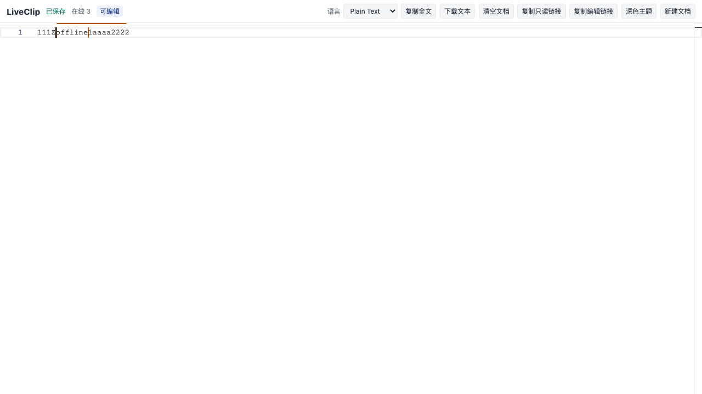

<div align="right"><a href="./README.md">English</a> | 简体中文</div>

<div align="center">

# LiveClip

运行在 Cloudflare Workers 上的实时协作剪切板。

[](LICENSE)
[](https://github.com/chius-me/live-clip/releases/latest)
[](https://github.com/chius-me/live-clip/actions)


[在线演示](https://liveclip.chius.dev) · [问题反馈](https://github.com/chius-me/live-clip/issues) · [Clip (保存并分享)](https://clip.chius.cc/)

</div>

打开同一个链接，多台设备同时编辑纯文本或代码。修改用 Yjs CRDT 实时同步，不会互相覆盖。

线上：https://liveclip.chius.dev

适合「打开就能写」。保存后再分享请用 [Clip](https://clip.chius.cc/)。



## 链接

| 类型 | 形式                       | 权限                                |
| ---- | -------------------------- | ----------------------------------- |
| 只读 | `/p/{roomId}`              | 同步内容，不能写入                  |
| 编辑 | `/p/{roomId}#{editSecret}` | fragment 里的密钥即可编辑，无需注册 |

服务端只存密钥的 SHA-256。文档在最后一次编辑后 30 天自动删除。

## 架构

Cloudflare Worker 同时提供静态页、API 和 WebSocket。每个文档一个 Durable Object，SQLite 持久化 Yjs 快照与增量，WebSocket 使用 Hibernation API。不依赖 VPS、Redis、D1、KV 或 R2。

## 本地开发

需要 Node.js 20+。

```bash
npm install
npm run dev          # http://localhost:5173
npm run typecheck
npm run lint
npm test
npm run test:e2e     # 首次需 npx playwright install chromium
```

不要用 `file://` 打开构建产物。

## 部署

推送到 `main` 会通过 GitHub Actions 部署到 Cloudflare。也可本地执行：

```bash
npx wrangler login
npm run deploy
```

仓库 Secrets：`CLOUDFLARE_API_TOKEN`（权限用 Edit Cloudflare Workers）、`CLOUDFLARE_ACCOUNT_ID`。自定义域已绑 `liveclip.chius.dev`。

可选 Turnstile：`wrangler secret put TURNSTILE_SECRET`，并设置 `TURNSTILE_SITE_KEY`。未配置时创建房间不验证。

## 限制

纯文本 / 代码，无账号与历史。单文档默认 1 MiB，单房间 50 连接。知道编辑链接的人都能写。Durable Objects 按用量计费。

## 📄 许可证

本项目采用 [MIT 许可证](LICENSE) 开源发布。界面参考了 [Rustpad](https://github.com/ekzhang/rustpad) 的交互，未复制其服务端代码。

---

<div align="center">
  <sub>Crafted with ❤️ by <a href="https://chius.cc">Chius</a> · Powered by Cloudflare & GitHub</sub>
</div>
